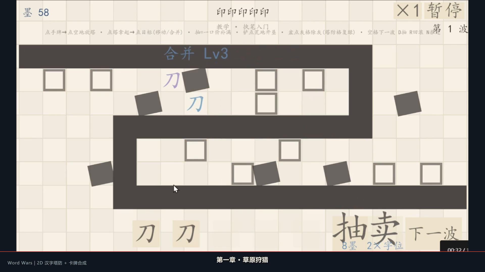

# Word Wars / 字塔防

**2D 汉字塔防 + 卡牌合成** · Unity 2022.3.62f2c1 · 独立开发

[▶ 在线试玩](https://lihanlin1.github.io/word-wars/)（部署后生效）



## 玩法

- **4 章 21 关**、17 种塔与功能卡、26 种敌人、4 个章节 Boss。
- 核心循环：抽卡 → 放塔 → **同字同级合成升阶** → 5 卡构筑 → 迎击波次 → 结算 / 回滚。
- 局内经济：一口价抽卡、卖塔回墨、铲荒地开垦、红铲造格、盆除灰。
- 章节机制：潮汐淹没、迷雾光照、火山喷发 / 灰烬格、Boss 多阶段。
- 完整闭环：主菜单、选关、教学、存档、暂停、2 倍速、音效、结算。

## 技术要点

- **逻辑 / 表现分层**：`BattleModel` 不依赖任何引擎对象，表现层通过事件订阅；`GameManager` 只做编排。
- **数据驱动**：关卡 / 塔 / 敌人 / 章节全部 `ScriptableObject` 配表，新增内容不改代码。
- **对象池**：`ViewPool` 复用敌人 / 塔 / 飘字 / 弹道视图，降低运行时分配。
- **Headless 模拟器**：`HeadlessSimulator` 用纯逻辑跑单关 100 局，输出胜率 CSV，用于调波次与数值。
- **Editor 工具**：`ProjectSetup` 场景 / 配置自愈；`WebGLBuilder` 一键导出 GitHub Pages 包。
- **AI 工作流**：使用 OpenCode / DeepSeek Harness 接入 GLM 模型，按需求文档 / ADR / 任务单生成并 Review 多文件代码，运行 Unity 验证后修正。

## 运行

1. 安装 **Unity 2022.3.62f2c1**。
2. 打开 `Assets/_Project/Scenes/MainMenu.unity`，点 Play。
3. 重新导出 WebGL：菜单 `Word Wars/Build/WebGL Demo`，输出到 `docs/`。

## 操作

| 操作 | 说明 |
|---|---|
| 点手牌 → 点空地 | 放置塔 |
| 点塔 → 点目标 | 拿起后移动 / 同字同级合并 |
| `D` | 抽卡（一口价补满） |
| `Space` | 下一波 |
| `R` | 回滚本关 |
| `N` | 推进下一关 |
| `P` | 暂停 |
| 右上角 `*1 / *2` | 切换倍速 |

## 目录

```
Assets/_Project/
  Scripts/
    Battle/      BattleModel、路径、塔/敌/弹道状态
    Card/        手牌、合成规则、塔池
    Core/        GameManager、存档、教学、参数
    Levels/      关卡 / 章节配置
    UI/          手牌条、卡牌、HUD、构筑面板
    Utils/       ViewPool 等
    Editor/      ProjectSetup、HeadlessSimulator、WebGLBuilder
  ScriptableObjects/  关卡 / 章节 / 塔池 / 敌人表 / 参数
  Scenes/        MainMenu、LevelSelect、Game
docs/            WebGL 构建（GitHub Pages）
media/           README 截图
```

## WebGL / GitHub Pages

构建产物在 `docs/`，已包含 `.nojekyll`。GitHub 仓库设置：**Settings → Pages → Source: Deploy from a branch → main / docs**。  
如果 GitHub 用户名或仓库名不是 `lihanlin1/word-wars`，把上方“在线试玩”链接替换成实际地址。

## 说明

- 项目仍在开发中；当前版本以玩法验证和工程结构为主，美术为程序化色块 / 文字。
- 截图来自实机演示视频；完整演示见简历中的视频链接。
- 代码仅用于作品展示与求职交流，未经许可请勿商用。
